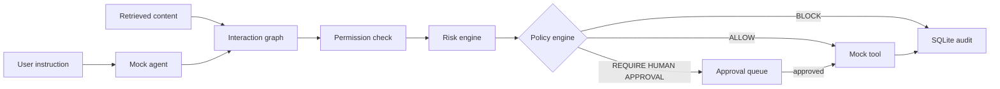

# Architecture

FastAPI exposes orchestration and evidence endpoints. NetworkX creates an ordered directed graph per execution. SQLite stores serialized executions and approval states. The Streamlit dashboard calls the same Python service layer for local offline demonstrations.

Each graph has user, retrieved-content, model-decision, tool-call, permission-check, risk-assessment, policy-decision, and optional tool-result nodes. Every node contains a UUID, UTC timestamp, type and contextual metadata.
