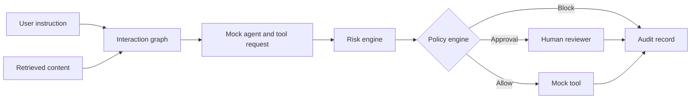

# GraphGuard Project Report

## Abstract

GraphGuard evaluates tool-using agent activity as a dynamic interaction graph. A transparent risk engine scores the requested tool, permission gap, untrusted retrieval source, prior action sequence and prompt-injection signals. The policy layer then allows, blocks or routes an action to a reviewer. The implementation runs entirely offline with mock tools.

## Architecture

## Evaluation protocol

The deterministic suite has 20 scenarios across benign use, direct and indirect injection, unauthorized access, sensitive exposure, excessive permissions, suspicious sequences and legitimate sensitive tasks. Each scenario runs against an unprotected agent, static permissions and GraphGuard. The evaluation writes raw scenario outcomes, aggregate metrics, JSON metadata and a chart. Values arise from the current run and are never hardcoded.

## Security limitations

GraphGuard is a teaching prototype. Its lexical injection detector does not identify every prompt injection, and scores depend on policy calibration. It does not substitute for authentication, least privilege, sandboxing, provenance validation, rate limits, secure secrets handling or production monitoring.
